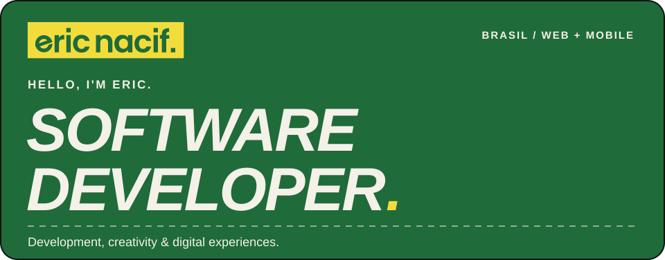

  

  
  
  

## About me

I'm Eric, a software developer from Brasil working across web and mobile applications. I'm interested in how technology, creativity and product development come together to make digital experiences that people enjoy using.

At **CertifiCafé**, I develop and maintain software for agricultural certification and due diligence, contributing to feature development, documentation, testing and code review. I also work on independent projects, from requirements and interface design to implementation.

## Tech stack

| Area | Technologies |
| :--- | :--- |
| Web | PHP, Laravel, JavaScript, HTML, CSS, jQuery, Bootstrap |
| Mobile | Dart, Flutter |
| Data | SQL, MariaDB |
| Workflow | Git, GitHub, automated testing, technical documentation |

## Selected work

**Eventuar — Business management software**  
Independent full-stack project for an events business. Customer management, scheduling, finance and business workflows. Built with Next.js, TypeScript and Supabase. In development; source code is private.

**CertifiCafé — Web & mobile software**  
Contributing to a production platform for agricultural certification, including checklists, due diligence and mobile application restructuring. Source code is private.

**[WhatsApp Bot Boilerplate](https://github.com/ericnacif/template-bot-whatsapp) — Open-source project**  
A configurable Node.js starter for WhatsApp automation, with modular flows, session management, Redis and automated tests.

## Off the keyboard

Away from the keyboard, I'm into comics, illustration, writing, music, cinema and video games. These interests shape how I approach creative work and digital experiences.

---

[Portfolio](https://ericnacif.com.br) · [LinkedIn](https://www.linkedin.com/in/eric-nacif/) · [Email](mailto:naciferic7@gmail.com)
